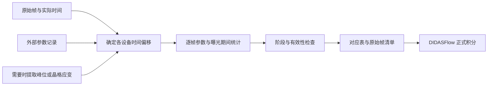

# InSituLink

**将原位实验的每个数据帧与温度、载荷、应力、应变等外部记录对应起来。**

InSituLink 将探测器帧时间映射到各设备的记录时间，输出逐帧参数、曝光期间统计量、时间偏移依据和原始帧清单，供 DIDASFlow 等后续程序进行正式积分。原项目名为 StrainLink。



每个原始帧保持独立。交接包引用原始数据，不复制或合并衍射帧。DIDASFlow 的 `handoff` 命令可读取本格式，对支持的 HDF5 帧执行逐帧 Full 一维 Q 积分，并保留时间、外部参数及其来源。InSituLink 负责生成交接文件，正式积分由用户在 DIDASFlow 中启动。

## 安装与演示

需要 Python 3.11 或更新版本。Windows PowerShell：

```powershell
py -3 -m pip install -e ".[preview]"
py -3 -m insitulink demo --case tensile --output output/demo-tensile
py -3 -m insitulink demo --case thermal --output output/demo-thermal
py -3 -m insitulink demo --case multi --output output/demo-multi
```

演示全部使用固定种子的合成数据。`tensile` 演示基于加载事件的偏移估计；`thermal` 故意同时包含设备偏移与样品响应延迟，返回 `needs_input`；`multi` 使用共同触发事件确定多个设备的独立偏移，并包含日志缺口和提前结束的记录。省略 `--output` 时会创建独立临时目录；已有演示输入不会被覆盖。

不使用 HDF5 或原始图像时可安装基本依赖：`py -3 -m pip install -e .`。`preview` 额外依赖包括 h5py、FabIO、pyFAI；通用 CLI 不需要 Qt、Tk 或 OriginPro。

## 处理自己的数据

先从实际文件生成请求草稿和待补字段清单：

```powershell
py -3 -m insitulink prepare --frames D:/experiment/frames.csv --source mechanics=D:/experiment/load.csv --output D:/experiment/setup
```

`prepare` 读取列名与元数据，生成 `experiment.json`、可复用的 `profile.json`、导入预览和具体待办。多个设备重复使用 `--source ID=PATH`；已有设备配置可用 `--profile PATH`。未声明的物理单位、时间语义和同步依据仍需补齐，不会自动确认零偏移。原文件保持不变；输出目录必须是新目录。

按 [请求文件说明](docs/REQUEST.md) 补齐草稿，也可继续使用自己编写的版本 1 请求：

```powershell
py -3 -m insitulink run --request D:/experiment/setup/experiment.json --output D:/experiment/results
py -3 -m insitulink inspect --output D:/experiment/results
py -3 -m insitulink resume --output D:/experiment/results
```

程序不修改原始输入。输出为机器可读 JSON，退出码为 `0` 完成、`2` 需要输入或确认、`1` 运行或交付失败；成功读取运行中快照的 inspect 也返回 0。`resume` 重新验证当前输入，复用仍然有效的阶段。离线打开结果目录中的 `report.html` 查看曲线和判断依据。

报告可搜索和筛选逐帧记录，查看原始位置、曝光区间、外部参数来源及无效原因。页首分别显示对齐结果和原始数据就绪情况；日志缺口保留断线，阶梯量按保持规则绘制。帧身份与本次处理记录见 [逐帧身份与追溯](docs/FRAME_IDENTITY.md)。

Agent 使用方式见 [AGENTS.md](AGENTS.md)。确定性计算在本地完成，包内没有大模型调用或网络服务。

真实数据解释案例：[HEPS G14 拉伸 TXT 列含义与踩坑记录](docs/HEPS_20261027_G14_TENSION2010_COLUMN_SEMANTICS.md)。该文件的“变形mm”存在表头与数值尺度冲突，应先核查列间关系再换算应变；此案例不构成所有 Tension2010 文件的默认单位规则。

## 交给 DIDASFlow 正式积分

在 DIDASFlow 的 `didasflow/` 目录中，使用实际标定建立的 DIDASFlow profile：

```bash
python run_cli.py handoff --handoff ALIGN/handoff.json --profile profile.json --output RESULTS
```

这里的 `profile.json` 是 DIDASFlow 积分配置，包含 `scan_template`、`diffraction_exp` 等输入，与 InSituLink `prepare` 生成的导入配置不同。当前入口使用内置 Full 一维 Q 工作流，支持二维或三维 HDF5 数据集中的完整二维帧；显式请求其他积分产品或自定义工作流会被拒绝。配置、迁移和恢复方法见 [DIDASFlow 交接使用说明](https://github.com/D-sudoasd/DIDASFlow/blob/main/didasflow/docs/insitulink-handoff.md)。

`completed` 表示对齐完成；`ready_for_integration` 也不能替代 DIDASFlow 对原始文件、数据集、物理帧索引、来源哈希和标定的检查。交付时保留完整对齐输出、原始请求、帧时间表、外部日志和同步依据。消费者按原采集顺序处理明确选择的帧，保留全部原始记录；选中帧的参数无效或缺失时，仍保留其值、空值、标志和来源，不将它们补零或自动删除该帧。

输入未变时，重复同一命令可复用已验证结果或继续未完成的任务。文件迁移使用 `--path-map map.json` 明确指定旧路径到当前路径的对应关系；来源、位置或标定发生变化后，使用新输出目录或 `--existing-output versioned` 保留此前结果。`--dry-run` 执行交接与积分预检，不产生新的谱，也不覆盖此前完成的交接结果。

## 输入、对齐与输出

| 项目 | 支持范围 |
| --- | --- |
| 帧信息 | CSV、XLSX、JSON、Eiger/NeXus HDF5 元数据；TIFF/CBF 序列使用逐帧时间表 |
| 外部参数 | 多设备、多通道；连续测量量和阶梯保持量；每个通道声明单位 |
| 时间关系 | 已确认的偏移或共同计时、人工或触发时间锚点、按需衍射事件候选 |
| 衍射预分析 | 已有一维谱；或具有明确 PONI 几何、波长、掩膜和校正设置的二维帧一维积分 |
| 参数统计 | 曝光中点值、时间加权均值、最小值、最大值、覆盖率和有效性 |
| 交付 | 逐帧 CSV、身份与参数来源记录、峰拟合结果、帧清单、偏移依据、DIDASFlow 交接 JSON、离线可筛选报告 |

固定偏移约定为 `外部记录时间 = 探测器时间 + Δt`。独立设备分别对齐，只有确认共用计时和起点的通道才共享偏移。

实际帧时间优先；通过采集周期重建时间需要显式确认。未解决的偏移为 `null`，不是默认零。程序不拉伸时间轴、不在记录范围外外推、不跨越长日志缺口插值。

这句话只约束 insitulink。strainlink 的未解析事件仍发布数字 0，并带 onset_unresolved，那个 0 不是测到的零点。insitulink 1.2.0 增加显式 scan_span 墙钟：请求给出确认过的 start_s、end_s、exposure_s 和帧数时，曝光中点为 start_s + i*(end_s-start_s)/(n-1)+exposure_s/2。名义周期只做核对，不写回帧时间，也不拉伸已有的实测间隔。两条弹性形状相关都至少 0.95 且相差小于 0.1 时发布墙钟，不确定度是两个 Δt 的绝对值之差。扇区形状门、应变可靠性标志和 continuation_of 都必须写在请求里，不能从文件名推断。

基线帧保留；加载、卸载、升温、降温和保持按时间顺序标注。

内部计算将精确时间起点与相对秒分开保存，避免短曝光在 UTC 浮点秒中丢失。设备重启或不一致锚点需要分段证据，不能按曲线吻合自动修正漂移。事件估计同时检查缺口和越阈时刻对信号噪声的敏感性。

仅靠温度与峰位变化不能区分设备起点偏移和实际热响应延迟，此类结果保留为候选。峰拟合不自动给出物相或 hkl；拟合不确定度不包含标定误差。

## 兼容原 StrainLink

旧命令和 Python 接口继续可用：

```powershell
py -3 -m strainlink align --demo heps_id07_eiger
py -3 -m strainlink align --demo extracted_frame_clock
```

旧接口规则见 [帧–拉伸时间对齐文档](docs/TIME_ALIGNMENT.md)。参考曲线应力–应变映射 GUI 仍可双击 `start_stress_strain_mapper.bat`，或运行 `py -3 sxrd_stress_strain_mapper_gui_v3.py`。其输出是参考曲线插值估计；最大值缩放、参考曲线反插值等功能与通用时间对齐分开。

## 验证

```powershell
py -3 -m unittest discover -s tests -v
```

检查范围见 [验证说明](docs/VALIDATION.md)。目前没有真实线站数据，软件测试与合成结果不代表实际实验精度或标定正确性。

MIT License。源代码：[D-sudoasd/InSituLink](https://github.com/D-sudoasd/InSituLink)。

真实数据后续：[TC4五样品逐文件核查与G21面积修正](docs/HEPS_20261027_TC4_FIVE_COLUMN_AUDIT.md)。G9仅保留峰前候选，G13完整应变仍无法从现有TXT恢复；G21按现场面积修正应力，应变不变。

真实数据模型：[G13参考应力–应变估计](docs/HEPS_20261027_G13_REFERENCE_STRAIN_MODEL.md)。新增模型估计应变，原应力与候选时钟保持；原失效通道不改写，峰后条件估计另标。
