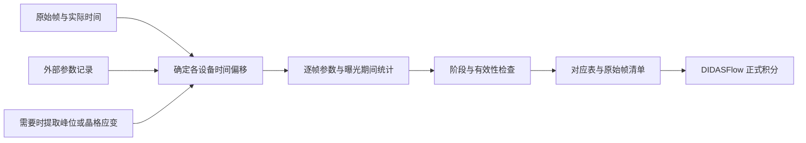

# InSituLink

**将原位实验的每个数据帧与温度、载荷、应力、应变等外部记录对应起来。**

InSituLink 将探测器帧时间映射到各设备的记录时间，输出逐帧参数、曝光期间统计量、时间偏移依据和原始帧清单，供 DIDASFlow 等后续程序进行正式积分。原项目名为 StrainLink。



每个原始帧保持独立。交接包引用原始数据，不复制或合并衍射帧。本版完成文件交接格式，DIDASFlow 尚未自动读取这份新格式。

## 安装与演示

需要 Python 3.11 或更新版本。Windows PowerShell：

```powershell
py -3 -m pip install -e ".[preview]"
py -3 -m insitulink demo --case tensile --output output/demo-tensile
py -3 -m insitulink demo --case thermal --output output/demo-thermal
py -3 -m insitulink demo --case multi --output output/demo-multi
```

演示全部使用固定种子的合成数据。`tensile` 演示基于加载事件的偏移估计；`thermal` 故意同时包含设备偏移与样品响应延迟，返回 `needs_input`；`multi` 使用共同触发事件确定多个设备的独立偏移，并包含日志缺口和提前结束的记录。省略 `--output` 时会创建独立临时目录；已有演示输入不会被覆盖。

不使用 HDF5 或原始图像时可安装基本依赖：`py -3 -m pip install -e .`。`preview` 额外依赖包括 h5py、FabIO、pyFAI；通用 CLI 不需要 Qt、Tk 或 OriginPro。

## 处理自己的数据

按 [请求文件说明](docs/REQUEST.md) 建立 `experiment.json`：

```powershell
py -3 -m insitulink run --request D:/experiment/experiment.json --output D:/experiment/results
py -3 -m insitulink inspect --output D:/experiment/results
py -3 -m insitulink resume --output D:/experiment/results
```

程序不修改原始输入。输出为机器可读 JSON，退出码为 `0` 完成、`2` 需要输入或确认、`1` 运行或交付失败；成功读取运行中快照的 inspect 也返回 0。`resume` 重新验证当前输入，复用仍然有效的阶段。离线打开结果目录中的 `report.html` 查看曲线和判断依据。

Agent 使用方式见 [AGENTS.md](AGENTS.md)。确定性计算在本地完成，包内没有大模型调用或网络服务。

## 输入、对齐与输出

| 项目 | 支持范围 |
| --- | --- |
| 帧信息 | CSV、XLSX、JSON、Eiger/NeXus HDF5 元数据；TIFF/CBF 序列使用逐帧时间表 |
| 外部参数 | 多设备、多通道；连续测量量和阶梯保持量；每个通道声明单位 |
| 时间关系 | 已确认的偏移或共同计时、人工或触发时间锚点、按需衍射事件候选 |
| 衍射预分析 | 已有一维谱；或具有明确 PONI 几何、波长、掩膜和校正设置的二维帧一维积分 |
| 参数统计 | 曝光中点值、时间加权均值、最小值、最大值、覆盖率和有效性 |
| 交付 | 逐帧 CSV、峰拟合结果、帧清单、偏移依据、DIDASFlow 交接 JSON、离线 HTML 报告 |

固定偏移约定为 `外部记录时间 = 探测器时间 + Δt`。独立设备分别对齐，只有确认共用计时和起点的通道才共享偏移。

实际帧时间优先；通过采集周期重建时间需要显式确认。未解决的偏移为 `null`，不是默认零。程序不拉伸时间轴、不在记录范围外外推、不跨越长日志缺口插值。基线帧保留；加载、卸载、升温、降温和保持按时间顺序标注。

仅靠温度与峰位变化不能区分设备起点偏移和实际热响应延迟，此类结果保留为候选。峰拟合不自动给出物相或 hkl；拟合不确定度不包含标定误差。

## 兼容原 StrainLink

旧命令和 Python 接口继续可用：

```powershell
py -3 -m strainlink align --demo heps_id07_eiger
py -3 -m strainlink align --demo extracted_frame_clock
```

旧接口规则见 [帧–拉伸时间对齐文档](docs/TIME_ALIGNMENT.md)。参考曲线应力–应变映射 GUI 仍可双击 `start_stress_strain_mapper.bat`，或运行 `py -3 sxrd_stress_strain_mapper_gui_v3.py`。其输出是参考曲线插值估计；最大值缩放、参考曲线反插值等功能与通用时间对齐分开。

## 验证

```powershell
py -3 -m unittest discover -s tests -v
```

检查范围见 [验证说明](docs/VALIDATION.md)。目前没有真实线站数据，软件测试与合成结果不代表实际实验精度或标定正确性。

MIT License。源代码：[D-sudoasd/InSituLink](https://github.com/D-sudoasd/InSituLink)。
